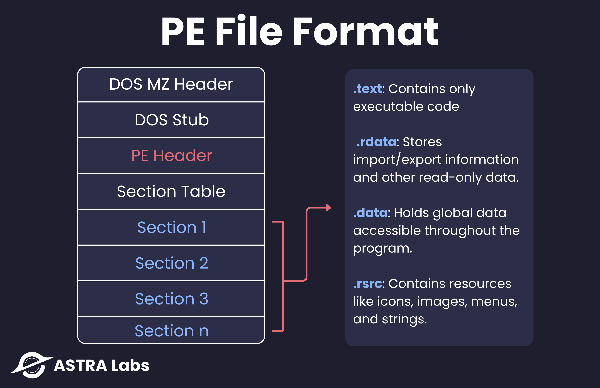

<p align="center">
  
</p>

<h1 align="center">PE Entropy Analyzer</h1>

<p align="center"><b>GhostByteSec</b> &mdash; Learn. Defend. Stay Safe.</p>

<p align="center">
  
</p>

A small, focused Python tool that statically inspects the sections of a Windows PE file (EXE or DLL), calculates the Shannon entropy of each section, and flags sections with entropy of **7.0 or higher** as `INVESTIGATE`.

It is built for beginner cybersecurity learners, Python developers, SOC analysts, and malware-analysis students. The tool **never executes** the file it analyzes.

## What the tool does

1. Loads a Windows PE file with Python and [`pefile`](https://github.com/erocarrera/pefile).
2. Walks the PE section table.
3. Reads each section's name and raw size.
4. Calculates the section's Shannon entropy (0.0 to 8.0 bits per byte).
5. Prints the score in a table.
6. Flags sections with entropy >= 7.0 as `INVESTIGATE`.

High entropy is a clue, not proof of malware. See [docs/ENTROPY.md](docs/ENTROPY.md).

## Example output

> **Illustrative example.** This is real output from the tool, but it was produced from a small synthetic PE-shaped test file generated for this repository (the same kind of file the unit tests build). It is not a real program or malware sample, and the numbers say nothing about any real software.

```text
=================================================================
       GHOSTBYTESEC - PE ENTROPY ANALYZER
=================================================================

[+] File: demo.bin
[+] Analysis: Static PE section inspection

-----------------------------------------------------------------
SECTION         RAW SIZE     ENTROPY   STATUS
-----------------------------------------------------------------
.text               5120        3.50   NORMAL RANGE
.rdata              1536        3.39   NORMAL RANGE
.packed             4096        7.95   INVESTIGATE
-----------------------------------------------------------------

[+] Analysis completed.
[!] High entropy is a clue, not proof of malware.
```

## Requirements

- Python 3.8 or newer
- [`pefile`](https://pypi.org/project/pefile/) (installed from `requirements.txt`)
- Git (to clone the repository)

## Installation

Run the commands one at a time.

### Kali Linux / Debian / Ubuntu

**Step 1 - Update packages.** Refreshes the list of available software.

```bash
sudo apt update
```

**Step 2 - Install Python, pip, virtual environment support, and Git.** Gives you everything needed to run the project.

```bash
sudo apt install -y python3 python3-venv python3-pip git
```

**Step 3 - Clone the repository.** Downloads the project. Replace `GhostByteSec` with the account that hosts the repository.

```bash
git clone https://github.com/GhostByteSec/pe-entropy-analyzer.git
```

**Step 4 - Enter the directory.** Moves your terminal into the project folder.

```bash
cd pe-entropy-analyzer
```

**Step 5 - Create a virtual environment.** Makes an isolated `.venv` folder so the dependency does not touch your system Python.

```bash
python3 -m venv .venv
```

**Step 6 - Activate it.** Your prompt will show `(.venv)` when it is active.

```bash
source .venv/bin/activate
```

**Step 7 - Upgrade pip.** Ensures you have a current package installer.

```bash
python -m pip install --upgrade pip
```

**Step 8 - Install the dependency.** Installs `pefile`, the only third-party package.

```bash
pip install -r requirements.txt
```

**Step 9 - Check the help menu.** Confirms the script runs and shows its options.

```bash
python pe_entropy.py --help
```

**Step 10 - Run the analyzer.** Point it at a Windows EXE or DLL. The file is only read, never executed.

```bash
python pe_entropy.py /path/to/example.exe
```

### Windows PowerShell

```powershell
git clone https://github.com/GhostByteSec/pe-entropy-analyzer.git
cd pe-entropy-analyzer
py -m venv .venv
.\.venv\Scripts\Activate.ps1
python -m pip install --upgrade pip
pip install -r requirements.txt
python pe_entropy.py "C:\path\to\example.exe"
```

- `py -m venv .venv` creates an isolated environment.
- `.\.venv\Scripts\Activate.ps1` activates it. If PowerShell blocks the script, run `Set-ExecutionPolicy -Scope Process -ExecutionPolicy RemoteSigned` and try again.
- `pip install -r requirements.txt` installs `pefile`.
- The last command analyzes your file. Keep the quotes if the path contains spaces.

## Usage

```text
usage: pe_entropy.py [-h] [--version] file
```

| Option | Meaning |
| --- | --- |
| `file` | Path to a Windows EXE or DLL |
| `-h`, `--help` | Show the help menu |
| `--version` | Show the tool version |

Beginner tip: start with a harmless file such as `notepad.exe` (Windows) so you can see what normal output looks like before you analyze anything suspicious.

## Running the tests

The tests use no malware. They check the classification logic and build a tiny synthetic PE-shaped file in a temporary folder.

```bash
python -m unittest discover -s tests -v
```

## How to interpret entropy results

| Entropy (bits per byte) | Typical meaning | Tool status |
| --- | --- | --- |
| Close to 0 | Very repetitive data, such as padding | `NORMAL RANGE` |
| About 4 to 6 | Typical for compiled code and ordinary data | `NORMAL RANGE` |
| 7.0 and above | Compressed, encrypted, or packed data is likely | `INVESTIGATE` |

- `INVESTIGATE` means "look closer", not "malicious".
- Legitimate software also contains compressed data, such as images in `.rsrc` or installers.
- A `NORMAL RANGE` result does not prove a file is safe.

Details and examples: [docs/ENTROPY.md](docs/ENTROPY.md).

## Project structure

```text
pe-entropy-analyzer/
├── assets/
│   ├── ghostbytesec-logo.png
│   └── pe-file-format.png
├── docs/
│   ├── PE_FILE_FORMAT.md
│   ├── ENTROPY.md
│   └── SAFETY.md
├── tests/
│   └── test_pe_entropy.py
├── .gitignore
├── LICENSE
├── README.md
├── requirements.txt
└── pe_entropy.py
```

## Safety guidance

- Start with a harmless executable.
- Handle real malware only inside an isolated, disposable virtual machine with a snapshot.
- Never execute the sample.
- Never commit samples to GitHub.
- Only analyze files you are authorized to examine.

Full guide: [docs/SAFETY.md](docs/SAFETY.md).

## Limitations

- It checks section entropy only. It does not detect malware or give a verdict.
- It does not unpack, disassemble, or run anything.
- The 7.0 threshold is a rule of thumb, not a scientific boundary. Compressed or encrypted data from legitimate software can exceed it, and malware can lower its entropy on purpose.
- It reads only the PE section table. Data outside the sections (for example appended data) is not analyzed.
- It supports PE files only (Windows EXE and DLL), not ELF or Mach-O.

## Learning references

- [PE file format (Microsoft Learn)](https://learn.microsoft.com/en-us/windows/win32/debug/pe-format)
- [pefile on GitHub](https://github.com/erocarrera/pefile)
- [Entropy (information theory) on Wikipedia](https://en.wikipedia.org/wiki/Entropy_(information_theory))
- Local docs: [PE file format](docs/PE_FILE_FORMAT.md), [Entropy](docs/ENTROPY.md), [Safety](docs/SAFETY.md)

The PE infographic is by ASTRA Labs, as credited in the image.

## License

Released under the [MIT License](LICENSE). Copyright (c) 2026 GhostByteSec.
