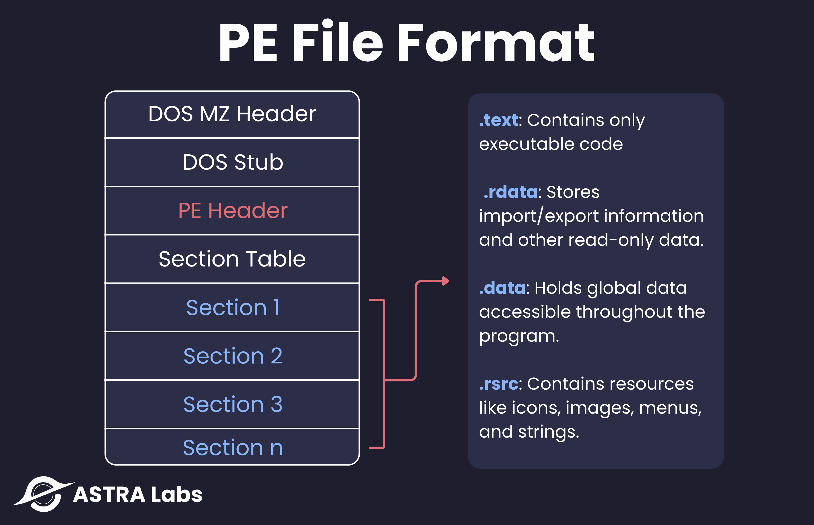

# PE File Format for Beginners

PE stands for **Portable Executable**. It is the file format Windows uses for programs (`.exe`), libraries (`.dll`), drivers (`.sys`), and more. Knowing its layout helps you see what the analyzer is reading.

## Overall layout

A PE file is a stack of headers followed by sections:

| Part | What it is |
| --- | --- |
| DOS MZ header | The first bytes of the file. Starts with `MZ`. Holds an offset that points to the PE header. |
| DOS stub | A tiny leftover DOS program. It typically prints "This program cannot be run in DOS mode." |
| PE signature | Four bytes, `PE\0\0`, marking the start of the modern headers. |
| COFF file header | Basic facts: target machine type, number of sections, timestamp, characteristics. |
| Optional header | Despite the name, it is required for EXEs and DLLs. It holds the entry point, image base, alignment values, and the data directory table. |
| Section table | One entry per section: name, virtual size, raw size, file offset, and flags. |
| Sections | The actual content: code, data, resources, and so on. |

In the infographic, "PE Header" covers the PE signature, COFF header, and optional header.

## Common sections

| Section | Conventional purpose |
| --- | --- |
| `.text` | Executable code |
| `.rdata` | Read-only data, including import and export information |
| `.data` | Global data accessible throughout the program |
| `.rsrc` | Resources such as icons, images, menus, and strings |
| `.reloc` | Base relocation information used when the file loads at a different address |

## Names are conventions, not guarantees

Compilers choose these names by convention. Nothing forces a section called `.text` to contain code, and a section with an odd name is not automatically suspicious. Packers and protectors often use custom names such as `UPX0`, but any author can name sections anything. Always judge a section by its contents and flags, not only its name.

## Where this tool fits

`pe_entropy.py` reads the **section table**, then measures each section's raw bytes:

1. Section name comes from the section table entry.
2. Raw size is `SizeOfRawData`, the section's size inside the file.
3. Entropy is calculated by `pefile` over those raw bytes.

Next: [Entropy](ENTROPY.md). Back to the [README](../README.md).
